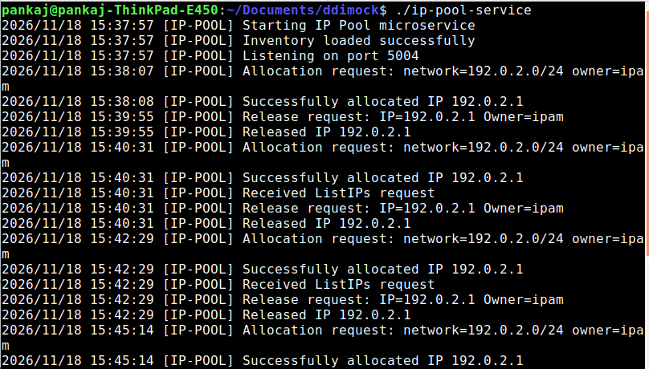
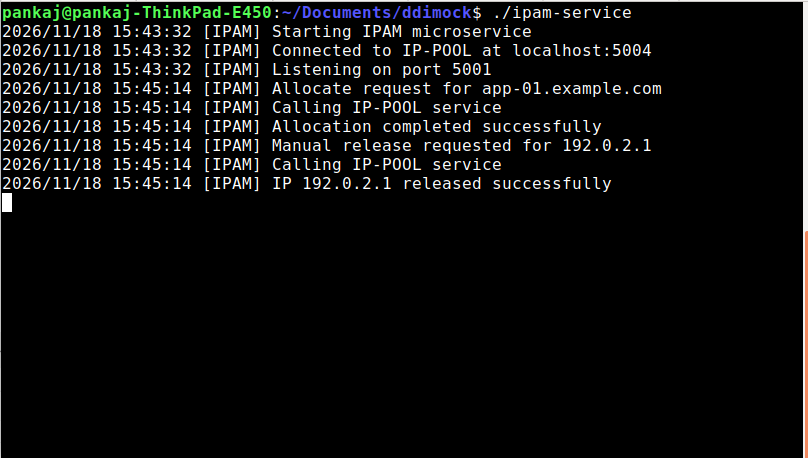
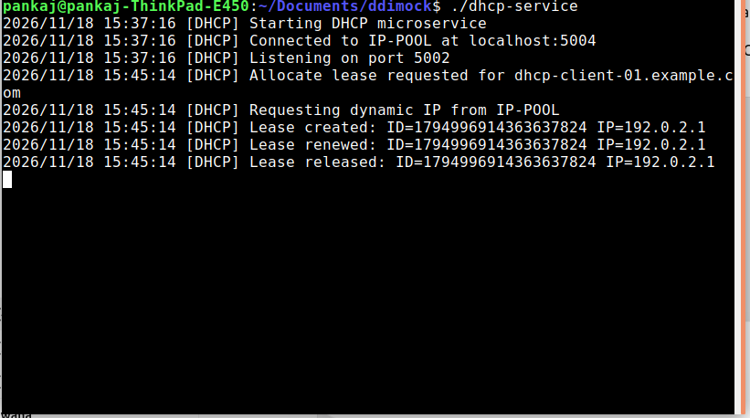
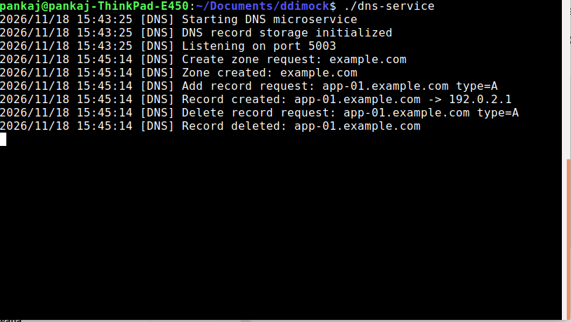
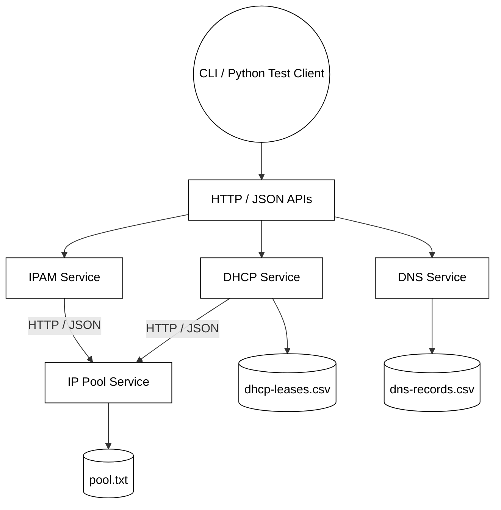
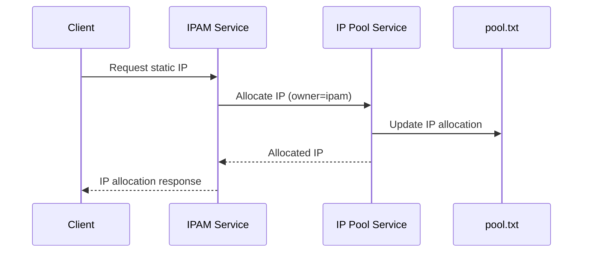
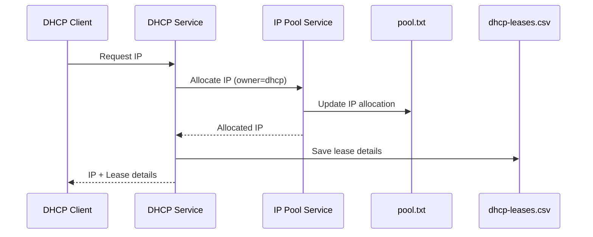
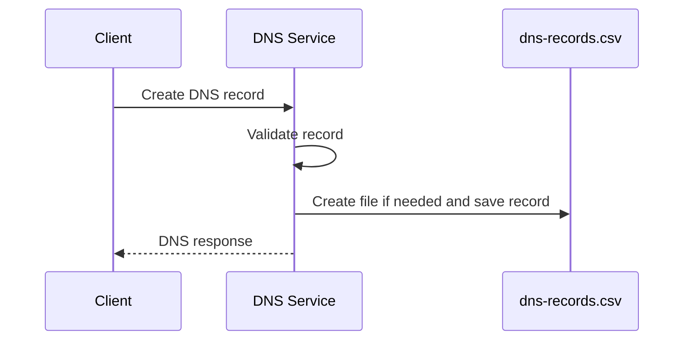

# DDIMock – Distributed DDI Microservices

## 1. Introduction

DDIMock is a sample **DDI (DNS, DHCP and IPAM) microservices project** developed to demonstrate how IP address management and DNS/DHCP services can be implemented using Go.

The project manages IP addresses within private networks and demonstrates communication between independent microservices using HTTP/REST and JSON.

The main objectives are:

- Manage IP addresses and their allocation states.
- Allocate and release IP addresses through IPAM.
- Manage DHCP leases with expiration and renewal.
- Create, retrieve and delete DNS records.
- Demonstrate independent microservices communicating over HTTP.
- Protect shared IP inventory from concurrent modifications.

This is a learning and demonstration project, not a production-ready DDI platform.

### 1. IP Pool Service


### 2. IPAM Service


### 3. DHCP Service


### 4. DNS Service


## 2. Architecture

The project contains three primary DDI microservices and one supporting IP Pool microservice.

| Service | Port | Responsibility |
|---|---:|---|
| IPAM | 5001 | Static IP allocation and release |
| DHCP | 5002 | Dynamic IP allocation and lease management |
| DNS | 5003 | DNS zone and record management |
| IP Pool | 5004 | Central IP inventory management |

### Architecture diagram



**Important architectural decision:** Microservices do not directly invoke each other's Go functions. They communicate through HTTP APIs using JSON. This keeps the services independently executable and loosely coupled.

## 3. Microservice responsibilities

### 3.1 IP Pool Service

The IP Pool service is the central inventory manager and the single source of truth for IP allocation.

The `pool.txt` file maintains the inventory of IP addresses, including their network, allocation state, hostname, MAC address and owner.

Supported IP states:

| State | Description |
|---|---|
| AVAILABLE | IP can be allocated |
| ALLOCATED | IP is assigned to a client |
| RESERVED | IP is reserved |
| QUARANTINE | IP is temporarily unavailable |

Responsibilities:

- Allocate an available IP.
- Release an allocated IP.
- Reserve and release reservations.
- Add and delete IP addresses.
- Maintain IP ownership information.
- Prevent conflicting allocations.

### 3.2 IPAM Service

IPAM handles static IP address allocation and release.

Responsibilities:

- Request an available IP from IP Pool.
- Associate the allocated IP with a hostname and MAC address.
- Release statically allocated IPs manually.
- Retrieve IP inventory information.

IPAM does not directly modify `pool.txt`. All inventory operations go through the IP Pool HTTP API.

**Static allocation rule:** An IP allocated through IPAM remains allocated until manually released. It does not have a DHCP lease.

### 3.3 DHCP Service

DHCP manages dynamic IP allocation and lease lifecycle.

Responsibilities:

- Request an available IP from IP Pool.
- Generate a DHCP lease ID.
- Maintain lease expiration information.
- Renew existing leases.
- Release IP addresses when leases are released or expire.

DHCP maintains its lease information in `dhcp-leases.csv`.

When a DHCP lease expires, DHCP requests IP Pool to release the corresponding IP address.

**Important:** DHCP can release only IP addresses owned by DHCP. It must not release static IPAM allocations.

### 3.4 DNS Service

DNS manages DNS zones and records independently.

Responsibilities:

- Create DNS zones.
- Add DNS records.
- Retrieve DNS records.
- List DNS records.
- Delete DNS records.

DNS maintains its records in `dns-records.csv`.

The DNS service does not directly allocate IP addresses. A DNS A record can point to an IP address allocated through IPAM or DHCP.

## 4. IP Pool concurrency and file protection

The IP Pool inventory is shared by IPAM and DHCP. Therefore, concurrent allocation and release requests must not corrupt the inventory.

The project uses three mechanisms to protect the inventory:

**1. Go Mutex (`sync.Mutex`)**

Prevents multiple goroutines within the same IP Pool process from modifying the inventory simultaneously.

**2. OS-level file locking (`syscall.Flock`)**

Provides exclusive file locking to coordinate multiple IP Pool processes accessing the same inventory file, provided they follow the same locking protocol.

**3. Temporary file and atomic rename**

Updates are written to a temporary file and then renamed to replace the original inventory file. This prevents readers from seeing a partially written inventory.

The overall process is:

```text
Incoming allocation request
          |
          v
     Acquire Mutex
          |
          v
    Acquire File Lock
          |
          v
     Read pool.txt
          |
          v
    Update IP inventory
          |
          v
 Write temporary file
          |
          v
    Atomic Rename
          |
          v
    Release File Lock
          |
          v
      Release Mutex
```

This is a file-based concurrency demonstration. A production implementation would generally use a transactional database with appropriate locking and durability guarantees.

## 5. IP allocation workflow

### IPAM workflow



### DHCP workflow



### DNS workflow



## 6. Project structure

```text
ddimock/
│
├── cmd/
│   ├── ip-pool/
│   │   └── main.go
│   ├── ipam/
│   │   └── main.go
│   ├── dhcp/
│   │   └── main.go
│   ├── dns/
│   │   └── main.go
│   └── cli/
│       ├── main.go
│       ├── ip.go
│       ├── dhcp.go
│       ├── dns.go
│       ├── host.go
│       ├── network.go
│       └── status.go
│
├── internal/
│   ├── ip-pool/
│   ├── ipam/
│   ├── dhcp/
│   └── dns/
│
├── data/
│   ├── ip-pool.txt
│   ├── dhcp-leases.csv
│   └── dns-records.csv
│
├── proto/
├── gen/
├── example/
│   └── test.py
│
└── README.md
```

## 7. Compilation

The project uses Go and the Go standard library for its HTTP microservices.

Run the following commands from the project root directory.

### Compile IP Pool

```bash
go build -o ip-pool-service ./cmd/ip-pool/
```

### Compile IPAM

```bash
go build -o ipam-service ./cmd/ipam/
```

### Compile DHCP

```bash
go build -o dhcp-service ./cmd/dhcp/
```

### Compile DNS

```bash
go build -o dns-service ./cmd/dns/
```

### Compile CLI

```bash
go build -o ddimock-cli ./cmd/cli/
```

## 8. Running the microservices

Start the services in separate terminal windows.

Run them from the project root so their relative data file paths resolve correctly.

### Terminal 1 – IP Pool

```bash
./ip-pool-service
```

Expected log:

```text
[IP-POOL] Starting IP Pool microservice
[IP-POOL] Inventory loaded successfully
[IP-POOL] Listening on port 5004
```

### Terminal 2 – IPAM

```bash
./ipam-service
```

IPAM connects to IP Pool on port 5004.

### Terminal 3 – DHCP

```bash
./dhcp-service
```

DHCP connects to IP Pool on port 5004.

### Terminal 4 – DNS

```bash
./dns-service
```

DNS runs independently on port 5003.

## 9. Example API commands

The following examples demonstrate how to interact with the microservices using `curl`.

### 9.1 Check service health

```bash
curl http://localhost:5004/health
curl http://localhost:5001/health
curl http://localhost:5002/health
curl http://localhost:5003/health
```

### 9.2 IPAM examples

**Allocate a static IP**

```bash
curl -X POST http://localhost:5001/allocate \
-H "Content-Type: application/json" \
-d '{
  "network": "192.0.2.0/24",
  "hostname": "app-01.example.com",
  "mac": "aa:bb:cc:00:00:50"
}'
```

**List IP addresses**

```bash
curl http://localhost:5001/ips
```

**Release an IP**

```bash
curl -X POST http://localhost:5001/release \
-H "Content-Type: application/json" \
-d '{
  "ip": "192.0.2.1"
}'
```

### 9.3 DHCP examples

**Allocate a dynamic IP with a 60-second lease**

```bash
curl -X POST http://localhost:5002/allocate \
-H "Content-Type: application/json" \
-d '{
  "network": "192.0.2.0/24",
  "hostname": "dhcp-client-01",
  "mac": "aa:bb:cc:00:00:60",
  "duration_seconds": 60
}'
```

**List active leases**

```bash
curl http://localhost:5002/leases
```

**Renew a lease**

Use the `lease_id` returned by the allocation response.

```bash
curl -X POST http://localhost:5002/renew \
-H "Content-Type: application/json" \
-d '{
  "lease_id": "YOUR_LEASE_ID",
  "duration_seconds": 120
}'
```

**Release a lease**

```bash
curl -X POST http://localhost:5002/release \
-H "Content-Type: application/json" \
-d '{
  "lease_id": "YOUR_LEASE_ID"
}'
```

### 9.4 DNS examples

**Create a DNS zone**

```bash
curl -X POST http://localhost:5003/zones \
-H "Content-Type: application/json" \
-d '{
  "zone": "example.com"
}'
```

**Create an A record**

```bash
curl -X POST http://localhost:5003/records \
-H "Content-Type: application/json" \
-d '{
  "name": "app-01.example.com",
  "type": "A",
  "value": "192.0.2.1",
  "ttl": "300",
  "zone": "example.com"
}'
```

**Retrieve a DNS record**

```bash
curl "http://localhost:5003/records?name=app-01.example.com&type=A&zone=example.com"
```

**Delete a DNS record**

```bash
curl -X DELETE \
"http://localhost:5003/records?name=app-01.example.com&type=A&zone=example.com"
```

## 10. End-to-end testing

The project includes a Python-based integration test.

It verifies the interaction between IPAM, IP Pool and DNS services.

Run:

```bash
python3 example/test.py
```

The test performs the following operations:

1. Checks whether all microservices are running.
2. Allocates an IP address through IPAM.
3. Creates a DNS zone.
4. Creates a DNS A record using the allocated IP.
5. Verifies the IP allocation.
6. Verifies the DNS record.
7. Releases the IP through IPAM.
8. Deletes the DNS record.

The test prints HTTP requests, JSON responses and verification results.

## 11. Technology stack

| Technology | Usage |
|---|---|
| Go | Microservice implementation |
| HTTP / REST | Inter-service communication |
| JSON | API request and response format |
| Protobuf | API and message schema definitions |
| Python | End-to-end integration testing |
| CSV / Text files | File-based data persistence |
| Linux system calls | File locking |

**Note:** Protobuf definitions are included in the project, but the current runtime microservices communicate using HTTP/JSON rather than gRPC.

## 12. Key design decisions

- IP Pool is the single owner of the IP inventory.
- IPAM and DHCP communicate with IP Pool through HTTP APIs.
- DNS maintains independent DNS record storage.
- Static IPAM allocations and DHCP lease-based allocations have different release rules.
- Concurrent inventory updates are protected using mutexes and OS-level file locking.
- Services are independently executable processes.
- HTTP/JSON communication avoids direct Go package dependencies between microservices.

---

**Project purpose:** Demonstrate the design and implementation of a small distributed DDI system using Go microservices, with emphasis on service separation, IP lifecycle management, API communication and concurrency control.
